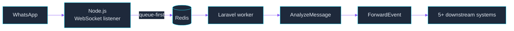

 

Cairo, Egypt &nbsp;|&nbsp; Available for remote roles

---

## About

Backend engineer building production-grade Laravel APIs, multi-tenant SaaS platforms, and AI-powered automation systems for international clients. I design the architecture, own delivery, and hold the code to a measurable quality bar.

| 100% | 12+ | 10,000+ | 1,700+ |
|:---:|:---:|:---:|:---:|
| Upwork job success | projects delivered | messages/day in one pipeline | Pest tests in one codebase |

---

## How I Work

| Area | What that looks like |
|:--|:--|
| **Architecture** | Modular monoliths with DDD and ports and adapters, multi-tenant isolation at the scope and database level, OpenAPI-documented REST APIs |
| **Reliability** | Queue-first ingestion, job isolation, exponential backoff, state machines for long-running jobs, 202 responses in under 100ms |
| **Quality** | PHPStan level 7, 1,700+ Pest tests, standardized Git workflows and code review |
| **Delivery** | Every freelance project shipped 1-2 weeks early with zero rework, leading to 5+ referrals and repeat contracts |

---

## Tech Stack

**Languages and Frameworks**

**Databases and Infrastructure**

**APIs, Tools and Integrations**

---

## Experience

<table>
<tr>
<td width="180"><b>Aug 2026 - Present</b> Full-time, Remote (Saudi Arabia)</td>
<td>

**Backend Software Engineer**, Birthofdream for Consulting & Research

- Architected the backend of a multi-tenant AI SaaS platform in **Laravel 13 / PHP 8.3**: modular monolith, DDD, ports and adapters, OpenAPI-documented REST APIs
- Built multi-tenancy with global Eloquent scopes and **RBAC (Spatie)**, including secure workspace switching
- Fixed gateway timeouts on 90-240s LLM jobs with queues, a state machine, and adaptive polling, returning **202 in under 100ms**
- Enforced quality with **PHPStan level 7** and **1,700+ Pest tests**

</td>
</tr>
<tr>
<td><b>May 2025 - Present</b> Upwork, Top Rated, 100% JSS</td>
<td>

**Freelance Backend Developer**

- Delivered 12+ backend projects for international startups and agencies, focused on API-heavy apps and backend automation
- Built an AI content management system that cut manual file packaging by **60%**, so the client could handle **10x more** monthly content
- Integrated the OpenAI API into WordPress, automating content workflows and cutting production time by **70%**
- Delivered every project 1-2 weeks early with zero rework, which led to 5+ referrals and repeat contracts

</td>
</tr>
<tr>
<td><b>Apr 2025 - Oct 2025</b> Part-time, Remote (New Zealand)</td>
<td>

**Backend Software Engineer**, GRASPED Digital

- Engineered 4+ AI-integrated PHP applications with a focus on reliability and pipeline stability
- Optimized queries and API response logic, taking average endpoint latency from **850ms to 580ms** (32% faster)
- Standardized Git workflows and code review, cutting merge conflicts by **80%** and speeding up team delivery 3x

</td>
</tr>
</table>

---

## Featured Projects

### CPA Client Collaboration Platform

`Laravel 12` `Livewire` `AWS S3` `DomPDF` `Stripe`

Multi-tenant SaaS for accounting firm operations, serving 50+ CPA practitioners.

- Modular multi-tenant system (DDD) with **database-level isolation**: 100% data separation across workspaces
- Full invoice lifecycle automated (PDF generation, scheduled reminders, async email), saving **40 hours/month** of manual work
- 2FA via Laravel Fortify, automatic suspension on failed logins, and S3 signed URLs for file access

### WhatsApp Event Monitoring System

`Node.js` `Laravel` `Redis` `WebSockets` `Supervisor/PM2`

A dual-stack pipeline turning **10,000+ daily WhatsApp messages** into structured telemetry.

- Sub-**20ms** response times under burst traffic
- Redis queue-first ingestion offloads payloads immediately and prevents socket backpressure
- Job isolation plus exponential backoff retries: **99.9% delivery reliability**

### AI PLR Content Generation System

`PHP (MVC)` `OpenAI API` `React`

An AI content pipeline that lets creators produce **100+ articles/week**.

- Throughput up **65%** with async multi-cURL requests, per-article API cost down **40%**
- Multi-format export (DOCX/HTML/TXT) with streaming and batch processing, server latency down **50%**
- Fault-tolerant retry logic holding a **99.9% job success rate** on long-running AI jobs

---

## GitHub Stats

---

**Open to:** Remote Backend Roles | AI Automation Projects | SaaS Architecture | Long-term Freelance

